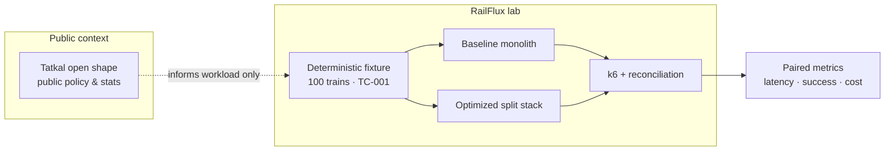
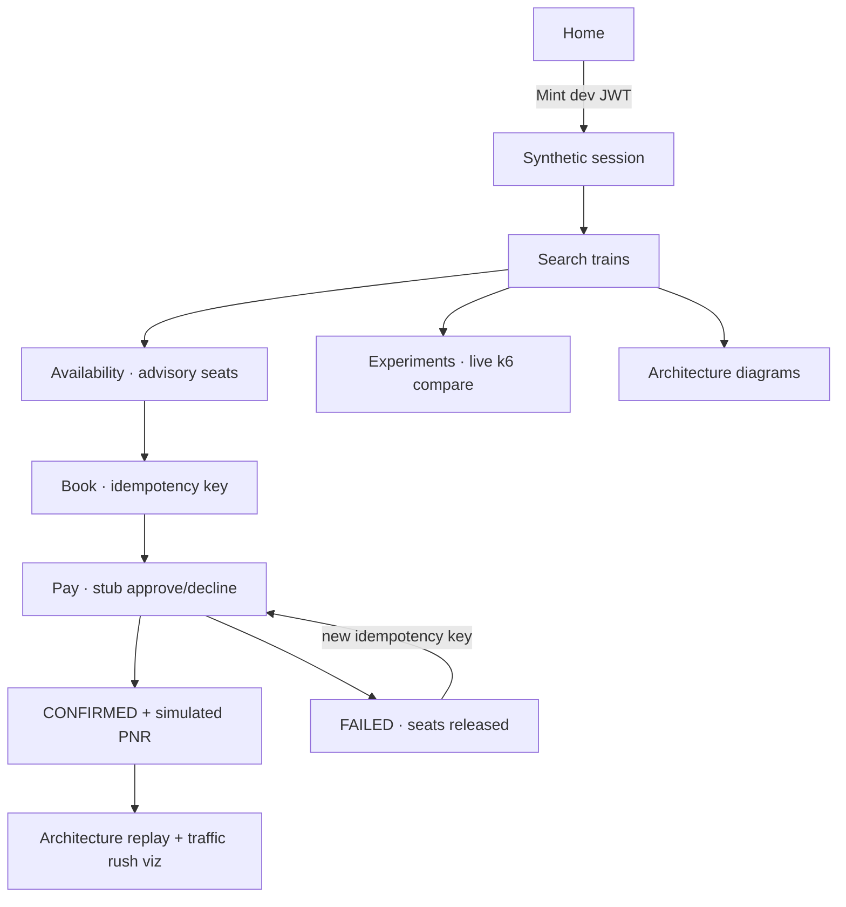
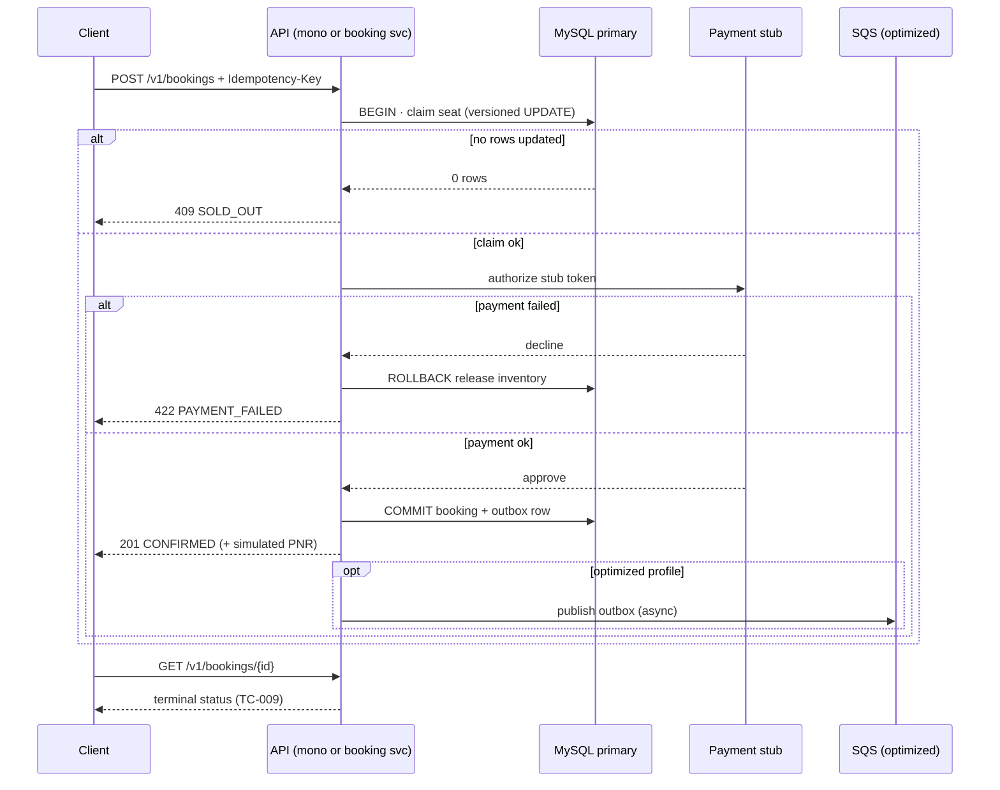
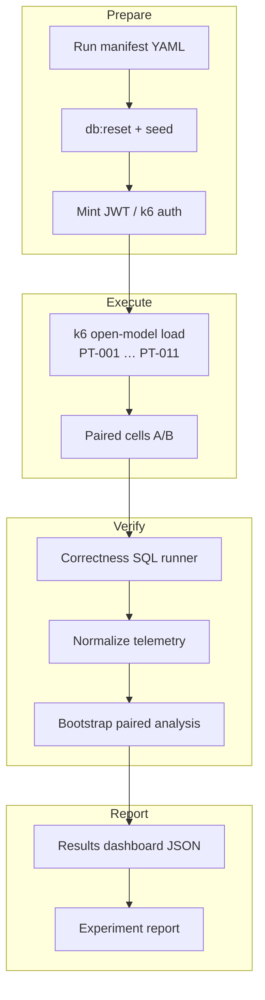

# RailFlux

**A Tatkal-shaped booking lab on AWS — not an IRCTC clone.**

RailFlux is an academic systems experiment: a **synthetic** railway reservation platform and a **paired measurement engine** that asks one question under controlled fairness rules:

> When a synchronized rush hits (search-heavy, seat-scarce, retry-prone), does a **read/write-separated, cache-aware, queue-backed** cloud design beat a **deliberately simple monolith** — without overselling a seat or breaking idempotency?

We shape traffic using **public** facts about Tatkal-style opens (herd timing, enquiry-heavy mix, bot pressure in policy discourse). **We do not implement, reverse-engineer, or claim parity with proprietary IRCTC / NGeT / CRIS internals.** The **baseline** is *our* reference “legacy-style” stack; the **optimized** stack is *our* AWS-native design. Both speak the same OpenAPI v1 contract and run against the same deterministic MySQL fixture.

---

## Table of contents

- [Why this exists](#why-this-exists)
- [Use cases & personas](#use-cases--personas)
- [Two engines under test](#two-engines-under-test)
- [End-to-end user journey](#end-to-end-user-journey)
- [Booking correctness path (sequence)](#booking-correctness-path-sequence)
- [Experiment & comparison workflow](#experiment--comparison-workflow)
- [Metrics we collect & compare](#metrics-we-collect--compare)
- [Hypotheses (preregistered)](#hypotheses-preregistered)
- [Test catalog (summary)](#test-catalog-summary)
- [Live demo (website + dual stack)](#live-demo-website--dual-stack)
- [Technology stack](#technology-stack)
- [Repository map](#repository-map)
- [Developer commands](#developer-commands)
- [Cost & AWS policy](#cost--aws-policy)
- [Documentation index](#documentation-index)
- [Definition of success](#definition-of-success)

---

## Why this exists

Tatkal-like sales create a **thundering herd**: many users and automated clients arrive at a known instant, read the same inventory, retry aggressively, and fight for a small number of seats. Average-load testing hides the real failure modes:

| Failure mode | What goes wrong |
| --- | --- |
| **Synchronized open** | CPU, DB connections, and thread pools saturate in seconds |
| **Read amplification** | Search + availability dwarf booking attempts but still hit the primary DB |
| **Stale reads** | Cached or replicated reads can *display* seats that are already gone |
| **Retry storms** | Duplicate POSTs without idempotency create double charges or ghost bookings |
| **Side effects on the hot path** | Notify/audit work on the request thread delays `CONFIRMED` |

RailFlux implements **both** a monolith baseline and a split optimized architecture, then compares them with **open-model k6**, **fixture reset**, **paired runs**, and **post-run SQL reconciliation** so numbers are defensible in an academic setting.



---

## Use cases & personas

| Persona | Goal | What they use in RailFlux |
| --- | --- | --- |
| **Legitimate passenger (synthetic)** | Book one Tatkal seat on a fixed journey date | React simulator: Search → Availability → Book → Pay → status |
| **Researcher / judge** | See baseline vs optimized under the same TC-001 probe | **Experiments** page: live k6 burst + paired booking probe |
| **Operator** | Reset inventory, mint JWT, run campaigns | `npm run db:reset`, `npm run mint:jwt`, experiment controller |
| **Bot-like client (k6 cohort)** | Flood search / trigger WAF cells | PT-009 mixes; optional WAF on CloudFront in AWS cells |
| **SRE / architect** | Understand failure isolation | FT-* tests: Redis down, worker paused, DLQ poison, DB delay |

**Primary demo journey (TC-001):** stations **SAB → SAA**, date **2026-04-01**, train **10061**, Tatkal **3A** inventory — but the catalogue supports **100 trains** and date-only browse lists all of them.

---

## Two engines under test

### Baseline — “Tatkal-shaped monolith” (our reference design)

Models a **single synchronous application**: search, availability, booking, payment stub, and outbox side effects share one Node process and one MySQL **primary**. There is no Redis; reads and writes contend on the same connection pool.

```text
Browser / k6
     │
     ▼
CloudFront → (optional WAF) → ALB
     │
     ▼
┌─────────────────────────────┐
│  Baseline monolith (ECS)     │
│  search · availability · book│
│  payment stub · outbox sync  │
└──────────────┬──────────────┘
               ▼
        MySQL primary (authoritative)
```

**Local:** `http://127.0.0.1:3000` — container `railflux-baseline`  
**Dual-stack compare:** baseline API on **:3000**, optimized on **:3001** (`npm run compare:dual-stack`).

### Optimized — “Cloud-native split path”

Same public API, different **separation of concerns**:

- **Read service** — search & **advisory** availability; Redis cache-aside; replica fallback on miss  
- **Booking service** — authoritative claim + payment on **primary only**  
- **SQS + worker** — notify/audit **after** commit (at-least-once; DLQ for poison)  
- **Edge router** — routes `/v1/search` & `/v1/availability` vs `/v1/bookings`

```text
Browser / k6
     │
     ▼
CloudFront → (optional WAF) → ALB
     │
     ├──────────────────┬─────────────────────┐
     ▼                  ▼                     ▼
 Read ECS          Booking ECS            Worker ECS
     │                  │                     │
     ▼                  ▼                     ▼
 Redis ──miss──►    MySQL primary ◄── claim   SQS ──► DLQ
              replica (reads)         outbox publish
```

**Local optimized profile:** edge on **:3000** (same URLs, different backend). See [Local Docker profiles](docs/local-docker-profiles.md).

### Side-by-side comparison (what we actually claim)

| Dimension | Baseline (monolith) | Optimized (split) |
| --- | --- | --- |
| **Read path** | Primary DB every time | Redis → replica; labelled HIT / MISS / BYPASS |
| **Booking authority** | Primary, synchronous | Primary, synchronous (unchanged correctness bar) |
| **Side effects** | Inline on request thread (baseline) | SQS worker; HTTP returns when DB commit succeeds |
| **Scale knob** | Scale whole monolith | Scale read vs booking vs worker independently |
| **Under enquiry-heavy burst** | Booking starved by search/availability | Read tier absorbs enquiry; booking fleet protects claims |
| **Cache truth** | N/A (always DB) | UI shows **advisory** freshness — never “cache = inventory” |
| **Failure isolation** | One process blurs all symptoms | FT-002 Redis, FT-003 worker, FT-004 DLQ are measurable |
| **What we compare to IRCTC** | **Nothing internal** — only public event *shape* (open second, mix ratios) |

---

## End-to-end user journey

The React **booking simulator** (M8) is the human-facing layer. It is **synthetic only** — fixture UUIDs and `npm run mint:jwt`, never real IRCTC credentials.



| Step | Route | Backend | Notes |
| --- | --- | --- | --- |
| Sign-in | Home / account menu | Browser mint or paste JWT | Same secret as `SYNTHETIC_JWT_SECRET` |
| Search | `/search?date=2026-04-01` | `GET /v1/search` | Optional `from` / `to`; date-only lists catalogue |
| Availability | `/availability?…` | `GET /v1/availability` | Returns `inventoryId`, freshness, **advisory** banner |
| Book | `/book?…` | `POST /v1/bookings` | Idempotency-Key required |
| Pay | `/pay?…` | Payment stub tokens | Approve / decline demo; ~2% fail sequence after reset |
| Status | `/bookings/:id` | `GET /v1/bookings/{id}` | Retry pay link on failure |

---

## Booking correctness path (sequence)

Both architectures must pass the same **TC-003–TC-009** integration bar: atomic claim, sold-out without negative inventory, idempotency replay/conflict, payment failure release, GET reconciliation.



**Idempotency** is for **safe retries** of the same booking intent — not for rejecting bots. **WAF** (when enabled in an experiment cell) drops bot-*like* traffic before the app; losers of a seat race see **SOLD_OUT** and pick another class/inventory in the UI demo.

---

## Experiment & comparison workflow

RailFlux separates **system under test** from **experiment plane** (fixtures, k6, manifests, reconciliation, dashboards). Baseline and optimized AWS profiles are normally measured **sequentially** on isolated, reset state — not simultaneously on one database.



**Website “Experiments” (live compare)** runs a **short** paired burst (`compare-burst.js`): same **70% search / 20% availability / 10% book** mix as PT-005, against `:3000` and `:3001`, then renders:

- p50 / p95 / **p99** latency  
- success / check rate  
- requests & RPS  
- optimized **cache HIT rate** (availability ops)

Plus a **TC-001 booking probe**: warmup, timed Search → Availability (optimized timed call often **HIT**) → Book on both stacks with compare-probe headers (fair latency; stub payment sleep skipped for measurement).

---

## Metrics we collect & compare

### Performance & capacity (k6 / dashboards)

| Metric | Definition | Typical compare use |
| --- | --- | --- |
| **p50 / p95 / p99 latency** | `http_req_duration` trends | Tail latency under burst (H2) |
| **Success / check rate** | k6 checks + HTTP failure rate | SLO-compliant capacity (H1) |
| **RPS & total requests** | Constant-arrival-rate scenarios | Throughput at fixed offered load |
| **Cache HIT / MISS / BYPASS** | Availability `freshness.cacheStatus` | PT-008; proves advisory path (H5) |
| **Calibrated capacity** | PT-002 stepped load | Baseline ceiling before optimized PT-004 |
| **Recovery time** | FT-* campaigns | Time to SLO after fault (H6) |
| **Cost parity** | vCPU-hours, RDS, ElastiCache window | **RPS/$** and total session cost |
| **Legitimate completion** | PT-009 cohort splits | Bot pressure vs genuine users (H4) |

### Correctness (always gating)

| Metric | Guarantee |
| --- | --- |
| **Inventory reconciliation** | `available_seats ≥ 0`; confirmed count matches claims |
| **Idempotency** | Same key + body → same outcome; same key + different body → conflict |
| **Payment failure** | No confirmed booking; seats returned |
| **Side-effect idempotency (optimized)** | TC-010: duplicate SQS delivery handled once |

### Architecture probe (browser / compare API)

| Field | Meaning |
| --- | --- |
| `searchMs` / `availabilityMs` / `bookingMs` | Per-step client timings on TC-001 |
| `cacheStatus` | Often `HIT` on optimized timed availability after warmup |
| `bookingStatus` | `CONFIRMED`, `SOLD_OUT`, or `FAILED` |
| `totalMs` | End-to-end for paired session |

Example interpretation (not fixed numbers — **run your own** campaign):

```text
                    Baseline          Optimized
p99 latency         higher            lower     ← design goal under H2
cache hit rate      n/a               high      ← read offload
booking correctness identical         identical ← must pass TC-* gates
```

---

## Hypotheses (preregistered)

These are **targets for measurement**, not marketing claims:

| ID | Statement |
| --- | --- |
| **H1** | At cost parity, optimized raises SLO-compliant offered booking capacity by ≥ **25%** |
| **H2** | At ~80% load, optimized p99 terminal booking latency ≤ **75%** of baseline |
| **H3** | Neither architecture oversells or double-charges |
| **H4** | Under bot-like pressure, optimized improves legitimate-user completion without harming legitimate-only cells |
| **H5** | Warm caching reduces read pressure without changing booking correctness |
| **H6** | Optimized recovers SLO compliance faster after a single-component failure |

Full protocol: [experiment/protocol.md](experiment/protocol.md) · Analysis: [paired bootstrap](experiment/analysis/) · Dashboard: `npm run experiment:results-dashboard`.

---

## Test catalog (summary)

| Class | IDs | Purpose |
| --- | --- | --- |
| **Functional** | TC-001 … TC-010 | Contract, cache, booking, idempotency, contention, payment, worker |
| **Performance** | PT-001 … PT-011 | Smoke, calibration, burst, mixed 70/20/10, contention, soak, elasticity |
| **Failure** | FT-001 … FT-009 | Task loss, Redis, worker, DLQ, DB delay, stampede coalescing |
| **Security** | ST-001 … ST-006 | WAF, origin lock, IAM, log redaction |

Complete list: [experiment/test-catalog.md](experiment/test-catalog.md).

**PT-005 traffic mix (Tatkal-like enquiry skew):**

```text
70%  GET /v1/search
20%  GET /v1/availability
10%  POST /v1/bookings
```

---

## Live demo (website + dual stack)

### Quick start (local)

```bash
# 1) Data + API stacks
npm run compare:dual-stack          # baseline :3000 + optimized :3001
MYSQL_HOST=127.0.0.1 MYSQL_PORT=3307 npm run db:load   # if needed

# 2) Frontend
npm run dev:frontend                # localhost dev (HMR)
# OR share via tunnel (production bundle — stable on ngrok):
npm run share:frontend              # build + preview on :5173

# 3) Synthetic auth
export SYNTHETIC_JWT_SECRET=dev-only-change-me
npm run mint:jwt
```

Open **http://127.0.0.1:5173** → mint JWT on **Home** → **Search** → **Experiments** (live k6) → complete a booking → **Architecture** / traffic animation on confirmation.

Detailed judge script: [docs/submission-demo.md](docs/submission-demo.md) · M8 gate: [docs/runbooks/m8-gate.md](docs/runbooks/m8-gate.md).

### Sharing with ngrok

Point ngrok at **5173**. Use **`npm run share:frontend`** for tunnels (single JS/CSS bundle). Mint JWT on Home; free-tier interstitials need **Visit Site** once, then hard-refresh. API calls use same-origin `/v1` proxy to your local backend.

---

## Technology stack

| Layer | Choices |
| --- | --- |
| **Frontend** | React 19, Vite, Tailwind, framer-motion simulator |
| **Services** | Node.js, TypeScript, Express (`baseline`, `read`, `booking`, `edge`, `worker`) |
| **Data** | MySQL 8 (local Docker / RDS); Redis (optimized); ElasticMQ / SQS |
| **Load** | k6 open-model scripts |
| **AWS** | CloudFront, S3, WAF, ALB, ECS Fargate, RDS, ElastiCache, SQS/DLQ |
| **IaC** | CloudFormation (`infrastructure/cloudformation/`) |
| **Region** | `ap-south-1` (CloudFront-scoped WAF in `us-east-1`) |

---

## Repository map

```text
packages/shared/          OpenAPI types, payment stub, synthetic JWT helpers
frontend/                 Booking simulator + live compare UI
services/
  baseline/               Monolith API profile
  read/ booking/ edge/ worker/   Optimized split profile
database/                 Migrations, deterministic seeds, reset scripts
load-tests/k6/            PT-* and compare-burst workloads
experiment/               Protocol, manifests, campaigns, analysis, dashboard
infrastructure/           Compose profiles + AWS deploy scripts
docs/                     Architecture, design, runbooks, milestones
tests/                    Unit, integration, gate tests
```

Each major directory has its own `README.md` with milestone scope.

---

## Developer commands

From repository root (Node **20+**):

| Command | Action |
| --- | --- |
| `npm run ci` | OpenAPI + fixture + typecheck + tests (GitHub Actions parity) |
| `npm run compose:baseline` / `compose:optimized` | Single-profile Docker stack |
| `npm run compare:dual-stack` | Baseline + optimized for Experiments page |
| `npm run db:reset` | Restore inventory / clear run state |
| `npm run mint:jwt` | Mint synthetic bearer token for curl/k6 |
| `npm run load:pt001` | PT-001 smoke load |
| `npm run compare:k6-burst` | CLI paired burst (same script as website) |
| `npm run share:frontend` | Production build + preview for ngrok |
| `npm run gate:m3` … `gate:m8` | Milestone acceptance scripts |

See [scripts/README.md](scripts/README.md).

---

## Cost & AWS policy

Development is **local-first**. Paid AWS runs are **ephemeral** measurement sessions (deploy → reset → measure → destroy).

| Guardrail | Value |
| --- | --- |
| Target spend | **$40–$70** |
| Stop-and-review | **$100** |
| Credit envelope | **$200** (account-dependent) |
| Avoid by default | NAT Gateway, always-on ElastiCache, Multi-AZ prod DB |

Details: [docs/operations/cost-plan.md](docs/operations/cost-plan.md).

---

## Documentation index

| Topic | Document |
| --- | --- |
| Charter & abstract | [PROJECT_DESCRIPTION.md](PROJECT_DESCRIPTION.md) |
| Unified architecture | [docs/architecture/system-overview.md](docs/architecture/system-overview.md) |
| Baseline vs optimized detail | [docs/architecture/baseline.md](docs/architecture/baseline.md), [optimized.md](docs/architecture/optimized.md) |
| Data & correctness | [docs/design/data-consistency.md](docs/design/data-consistency.md) |
| Public IRCTC evidence (workload only) | [docs/research/irctc-public-evidence.md](docs/research/irctc-public-evidence.md) |
| Assumptions & limits | [docs/assumptions-and-limitations.md](docs/assumptions-and-limitations.md) |
| Full doc tree | [docs/INDEX.md](docs/INDEX.md) |

---

## Definition of success

An optimization is accepted only when:

1. No inventory is oversold.  
2. No idempotency key creates multiple bookings or charges.  
3. Inventory and bookings reconcile after every run.  
4. The load generator is not the bottleneck.  
5. Both architectures receive the same seeded offered workload.  
6. Improvement is reported with uncertainty intervals and cost.  
7. Conclusions rest on **measured** artifacts, not estimates.

Checklist: [docs/definition-of-done.md](docs/definition-of-done.md).

---

## License & attribution

Academic experiment software — see repository license and course attribution as applicable. **Do not** use RailFlux against real railway systems or present it as IRCTC software.

---

<p align="center"><strong>RailFlux — measure the rush, prove the claim, keep the ledger honest.</strong></p>
