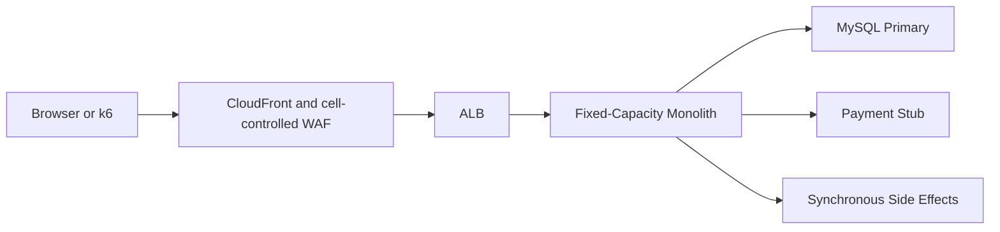

# Baseline Architecture

## Intent

The baseline is intentionally conventional and constrained. It provides a reproducible comparison target, not a reconstruction of IRCTC.

## Characteristics

- One deployable handles search, availability, booking, payment simulation, and side effects.
- One primary database handles all reads and writes.
- No Redis, read replica, SQS, worker, or application autoscaling.
- Application capacity is fixed for a complete measured run.
- Static frontend delivery may remain shared so the experiment measures application architecture rather than asset hosting.
- WAF and ALB configuration remain identical across paired runs unless the experiment explicitly studies ingress protection.

## Booking behavior

The baseline is still correct:

1. validate request and idempotency key;
2. begin transaction;
3. atomically claim inventory;
4. create booking, payment, and durable outbox record;
5. commit;
6. process the outbox event synchronously in the monolith and record the handler result;
7. return the terminal result.

The baseline uses the same outbox invariant as the optimized design but does not use SQS: its request thread performs the side effect synchronously. Removing correctness from the baseline would create an invalid performance advantage or straw-man comparison.

## Expected bottlenecks

- read traffic consumes primary DB connections and CPU;
- long synchronous side effects occupy application capacity;
- one service’s work can starve another;
- fixed compute cannot react to a burst;
- aggressive retries amplify overload.

These are hypotheses to measure, not predetermined results.

## Parity rules

The baseline and optimized systems share:

- endpoint schemas and response meanings;
- fixture and database indexes required for correctness;
- transaction isolation and inventory invariants;
- payment delay/failure sequence;
- application language and runtime;
- region and load-generator location;
- telemetry fields and run acceptance rules.
