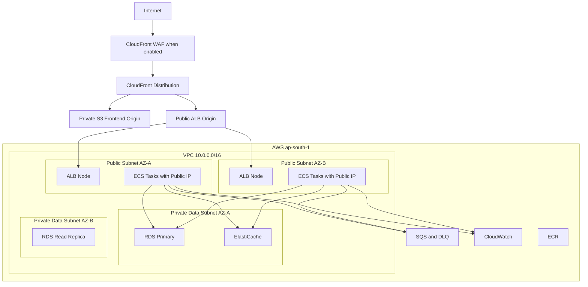

# AWS Network and Deployment Architecture

## Region and edge

- Application resources: `ap-south-1`.
- CloudFront is global.
- A WAF web ACL associated with CloudFront is managed in `us-east-1`.
- TLS uses ACM certificates in the region required by the attached service.

## Why tasks use public subnets

The low-cost academic profile avoids NAT Gateway hourly and processing charges. Fargate tasks receive public IPs for outbound ECR, SQS, Secrets Manager, and CloudWatch access, but:

- their security group allows application inbound only from the ALB security group;
- databases and cache remain private with no public endpoints;
- task roles, not embedded credentials, authorize AWS APIs;
- the ALB accepts traffic only from CloudFront origin-facing addresses and requires a secret origin header.

A production profile would normally use private application subnets plus VPC endpoints or managed NAT, but that is outside this budget.

## Security-group matrix

- ALB SG: inbound HTTPS from CloudFront origin-facing prefix list; outbound to ECS app ports.
- ECS SG: inbound app port only from ALB SG; outbound TLS, MySQL to RDS SG, and Redis to cache SG.
- RDS SG: inbound 3306 only from ECS SG.
- Redis SG: inbound 6379 only from ECS SG.

## Availability and cost trade-off

The ALB spans two Availability Zones. ECS can place tasks across both. The academic RDS primary remains Single-AZ, so database-AZ failure is an accepted limitation. A read replica is for read scaling, not automatic Multi-AZ failover.

## Deployment order

1. budget alarms, tags, artifact buckets, and ECR;
2. VPC, subnets, routes, and security groups;
3. SQS/DLQ;
4. RDS and migration/fixture;
5. optional ElastiCache and read replica;
6. ECS cluster, task definitions, and services;
7. ALB listeners, target groups, and routing;
8. private S3 frontend origin and CloudFront;
9. WAF rules for designated sessions;
10. dashboards, smoke test, and cost/expiry verification.
