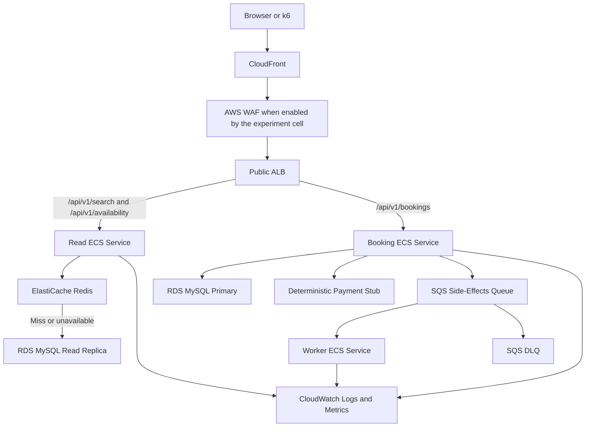

# Optimized AWS Architecture

## Logical architecture



## Why each optimization exists

- **Read/booking split:** protects transactions from high-volume enquiry traffic and permits independent scaling.
- **Redis:** absorbs repeated search and displayed-availability reads.
- **Read replica:** keeps cache misses off the primary. Replica lag is visible and never trusted for booking.
- **SQS:** removes notification, audit export, and analytics work from the response path.
- **Independent scaling:** read tasks follow CPU/ALB requests; booking tasks follow CPU/latency; workers follow backlog per task.
- **WAF/rate controls:** shed clearly abusive patterns before application work, while measuring legitimate false positives.

## Correctness boundary

The booking service ignores cached/replica availability for commitment. Its primary-database transaction performs an atomic claim:

```sql
UPDATE seat_inventory
SET available_seats = available_seats - :requested
WHERE inventory_id = :id
  AND available_seats >= :requested;
```

Exactly one affected row permits the booking. The booking, passengers, payment outcome, and idempotency response are stored consistently. Post-commit side effects are delivered at least once and processed idempotently.

## Scaling policy

- Read service: minimum 1 during tests; target tracking on CPU and ALB request count.
- Booking service: minimum 1 during tests; conservative maximum chosen by the run’s resource budget.
- Worker: minimum 0 outside tests; scales from CloudWatch SQS backlog alarms. Scale-from-zero delay is measured.
- Database/cache: fixed size within a paired experiment cell.

Autoscaling is disabled for resource-parity fixed-capacity experiments and enabled only in designated elasticity experiments.

## Cost controls

- Deploy the read replica and ElastiCache only for optimized measurement sessions.
- Use the smallest viable ARM Fargate and Graviton database/cache classes where service support permits.
- Do not use NAT Gateway; tasks receive public IPs for managed-service access but accept inbound traffic only from the ALB security group.
- Restrict the ALB origin to CloudFront’s origin-facing prefix list plus a secret origin header.
- Use S3 origin access control; never expose the frontend bucket.
- Keep logs 3–7 days and export only experiment artifacts.

## Degradation behavior

- Redis unavailable: reads fall back to the replica with bounded timeouts and reduced concurrency.
- Replica unavailable/lagging: non-authoritative searches may fall back to primary only under a protected low-concurrency mode; booking remains primary-only.
- Worker unavailable: committed bookings remain successful; queue depth and message age grow.
- Payment failure: transaction rolls back or releases inventory exactly once.
- Task failure: ALB removes unhealthy target and ECS replaces it.
