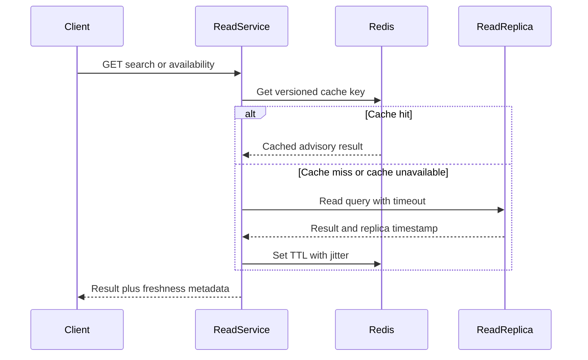
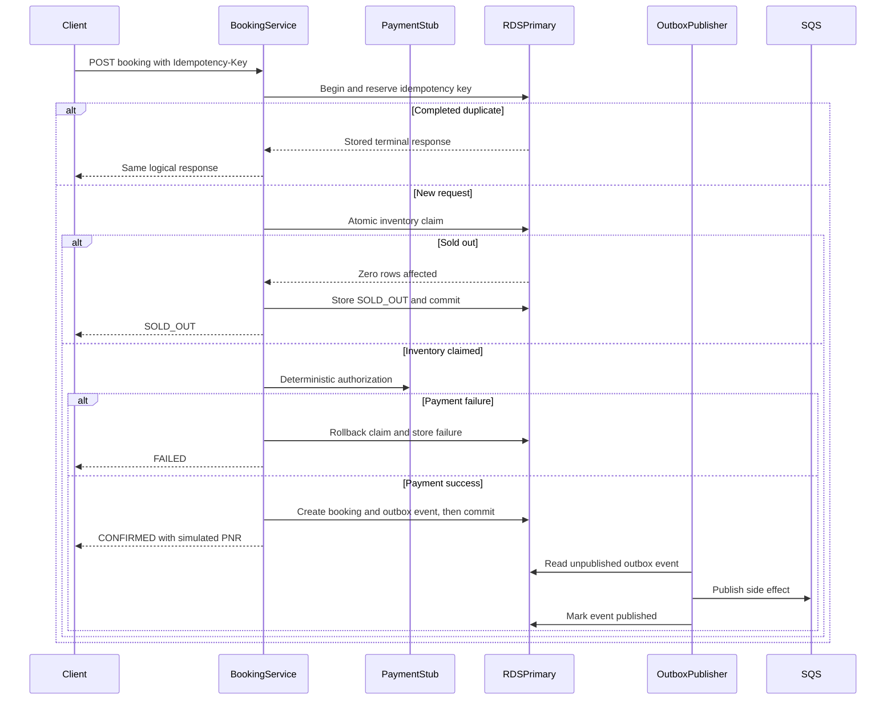

# Request and Failure Flows

## Search and displayed availability

Concurrent misses use single-flight/coalescing per key where practical to reduce cache stampedes. Search TTL is longer than availability TTL; both include jitter.

## Booking

The publisher is logically separate from the synchronous response path. A direct post-commit SQS send can lose side effects if the process stops between commit and publish. In baseline mode, the monolith processes the same durable outbox event synchronously without SQS.

## Worker delivery

SQS Standard is at-least-once and unordered:

1. receive with long polling;
2. claim a unique `(event_id, handler_type)` processing record;
3. perform the simulated side effect;
4. mark complete;
5. delete message;
6. after repeated failure, SQS redrive moves it to the DLQ.

## Client timeout after commit

The client may time out after the database commits but before receiving a response. Retrying the same idempotency key returns the committed result. Reconciliation treats client timeout as unknown until the booking status is queried.

## Cache failure

Redis calls use short timeouts and a circuit breaker. Reads fall back with bounded database concurrency. Booking is unaffected because it never depends on Redis.

## Worker failure

Bookings continue after durable commit/outbox creation. Queue depth and oldest-message age rise. Recovery is complete when the backlog drains and deduplication records show no repeated side effects.
