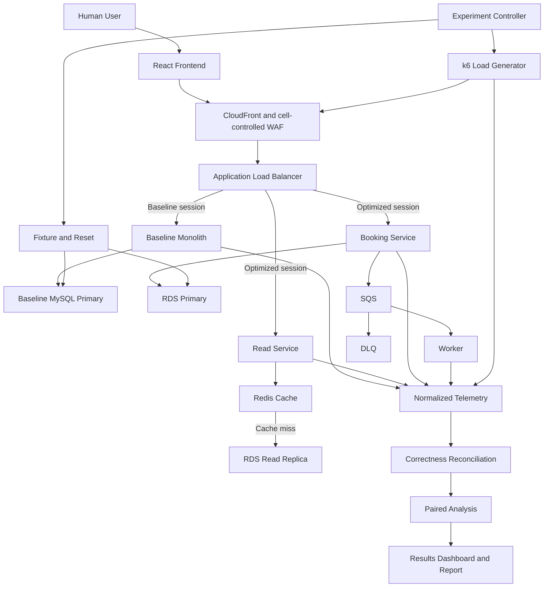

# Unified System Architecture

RailFlux has two planes:

1. **System under test:** website, ingress, application, and data services.
2. **Experiment plane:** fixture creation, traffic generation, telemetry, reconciliation, analysis, and reporting.

The branches are conceptual: baseline and optimized profiles are normally deployed and measured **sequentially**, not simultaneously.

## Runtime boundaries

- The frontend displays search, availability, booking, payment simulation, and confirmation.
- The edge layer serves static assets, applies managed/request-rate rules, and forwards `/api/*`.
- Every service implements the same versioned API contract and propagates `traceparent`, `run_id`, and `request_id`.
- The experiment controller is not on the customer request path.
- Results are written only after state reconciliation succeeds.

## Workload paths

### Read

Baseline reads query the primary database. Optimized reads use cache-aside Redis and fall back to a read replica. Displayed availability may be stale and is explicitly advisory.

### Booking

Both systems perform authoritative inventory validation on a primary MySQL transaction. The optimized service moves only non-critical post-commit work to SQS.

### Failure

Load and failure controls can stop a task, block Redis, delay a database call, pause workers, or fail the payment stub. Each failure is injected independently and recorded in the run manifest.

## Deployment profiles

- `local-baseline`: monolith + MySQL.
- `local-optimized`: read/booking services + MySQL + Redis + ElasticMQ + worker.
- `aws-baseline`: edge/ALB + monolith Fargate + Single-AZ RDS.
- `aws-optimized`: edge/ALB + split Fargate services + RDS primary/read replica + ElastiCache + SQS/DLQ + worker.

AWS profiles are temporary. Only one paid profile is required at a time.
