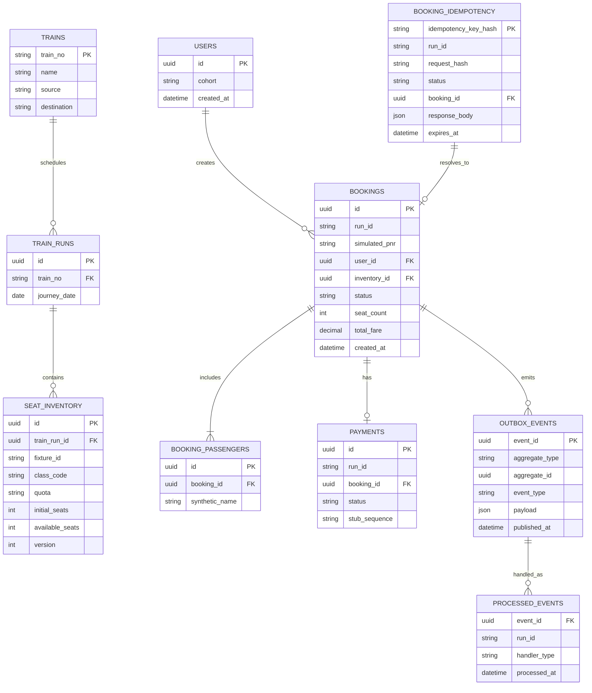
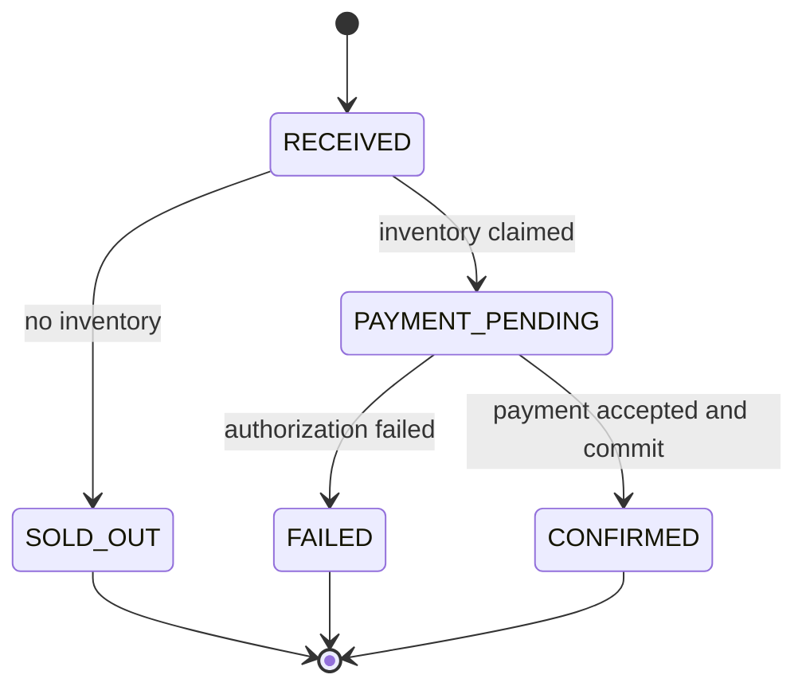

# Data, Transactions, and Correctness

## Core entities

## Booking state machine

For the MVP, payment authorization is inside the transaction to keep the state model small. Its delay is bounded. A production design would avoid holding a database lock across an external payment call and use expiring holds/compensation.

## Required constraints

- Unique idempotency key hash.
- Unique simulated PNR.
- `available_seats >= 0`.
- Booking seat count is positive and no more than four.
- Unique processed side-effect key `(event_id, handler_type)`.
- Foreign keys between inventory, booking, payment, passenger, and outbox rows.
- `run_id` tags mutable experiment records; `fixture_id` identifies seeded inventory.

## Invariants

1. `confirmed_seats <= initial_inventory`.
2. `initial_inventory - final_inventory = confirmed_seats` for runs without cancellation.
3. One idempotency key maps to one request hash and one logical result.
4. One booking has at most one successful payment.
5. Every confirmed booking has a durable outbox event.
6. Every accepted event is pending, processed, or in the DLQ.
7. Displayed stale availability cannot cause an oversell.

## Idempotency behavior

- Hash the key and canonical request body; do not log raw credentials or passenger data.
- Same key + same request returns the stored result.
- Same key + different request returns `409 IDEMPOTENCY_CONFLICT`.
- An in-progress duplicate may wait briefly or return `409/425` with a status URL.
- Expiry must exceed the maximum client retry/reconciliation period.

## Reconciliation

Every measured run executes independent SQL checks for negative inventory, duplicate keys, duplicate successful payments, outbox gaps, final inventory mismatch, orphan rows, and non-terminal accepted requests. Any violation invalidates the run regardless of latency.
