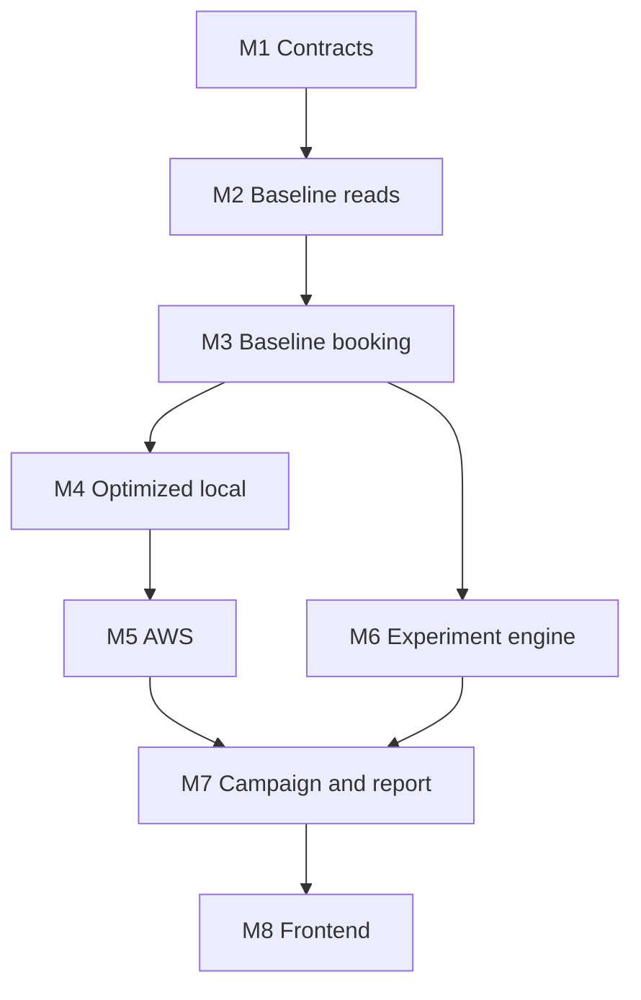

# RailFlux Implementation Plan

This document maps the repository from its **current planning-only state** to **Definition of Done** completion. The **React frontend is intentionally last** (Milestone M8); API clients, k6, and the experiment controller drive development and measurement until then.

Related: [Roadmap](roadmap.md) · [Definition of Done](definition-of-done.md) · [Test catalog](../experiment/test-catalog.md) · [Protocol](../experiment/protocol.md)

GitHub tracks execution via **milestones M1–M8**, **area/type/profile labels**, and linked issues.

---

## Readiness analysis (current → complete)

### What exists today

| Layer | Status | Notes |
| --- | --- | --- |
| Architecture & design | **Complete (planning)** | Baseline/optimized docs, flows, network, ADRs |
| API contract | **Frozen v1.0.0** | `design/api-spec.yaml` — see [ADR-011](decisions/ADR-011-api-v1-freeze.md) |
| Data model | **Specified** | ER diagram and invariants in `design/data-consistency.md` — not migrated |
| Experiment design | **Complete (planning)** | Protocol, hypotheses, manifests, correctness SQL template, result schema |
| Application code | **Missing** | No `frontend/`, `services/`, `database/`, `infrastructure/`, `load-tests/` |
| Local runtime | **Missing** | No Docker Compose, no seed/reset automation |
| AWS | **Account ready** | CLI profile `railflux`; IaC and deploy scripts not in repo |
| CI | **Baseline** | GitHub Actions `CI` workflow on push/PR to `main` (`npm run ci`) |
| Frontend | **Deferred** | Last milestone per team preference |

### Verdict

- **Ready to start implementation:** yes — contracts and experiment methodology are sufficient to scaffold M1 without rework.
- **Not ready to claim experiment results:** until M3 (local correctness), M5 (AWS profiles), and M6–M7 (calibration + paired runs) gates pass.
- **Highest risk if skipped:** booking invariants (M3), profile parity (M4), cost/teardown discipline (M5), generator validity (M6).

### Completion criteria (unchanged)

All items in [definition-of-done.md](definition-of-done.md) must be satisfied, with evidence from accepted runs in `experiment/runs/` and the final report from [report-template.md](../experiment/report-template.md).

---

## Milestone overview

| ID | Milestone | Target | Outcome |
| --- | --- | --- | --- |
| **M1** | Contracts & repository scaffold | Week 1 | **Done** — [M1 acceptance](milestones/M1-acceptance.md) |
| **M2** | Baseline read path (local) | Week 1–2 | **Done** — [M2 acceptance](milestones/M2-acceptance.md) |
| **M3** | Baseline booking correctness | Week 2 | **Done** — [M3 acceptance](milestones/M3-acceptance.md) |
| **M4** | Optimized local profile | Week 3 | Read/booking split, Redis, queue, worker, DLQ, parity + TC-002/TC-010 |
| **M5** | AWS infrastructure & observability | Week 4 | CloudFormation profiles, deploy/teardown, budgets, smoke session |
| **M6** | Experiment engine & load tests | Week 5 (early) | k6 workloads, controller CLI, manifests, artifact export, preflight |
| **M7** | Campaign, analysis & delivery | Week 5–6 | Calibration, principal pairs, stats, report, reproducibility audit |
| **M8** | Frontend booking simulator | After M7 | React/Vite UI, advisory labels, same API contract |

---

## Label taxonomy (GitHub)

| Label | Meaning |
| --- | --- |
| `area:contracts` | API, schema, fixtures, ADRs |
| `area:database` | Migrations, seeds, reconciliation SQL |
| `area:services-baseline` | Monolith baseline app |
| `area:services-optimized` | Read/booking/worker split |
| `area:infrastructure` | Docker Compose, CloudFormation, deploy scripts |
| `area:experiment` | k6, controller, manifests, analysis |
| `area:observability` | Logs, metrics, traces, dashboards |
| `area:security` | IAM, WAF, ingress hardening |
| `area:frontend` | React simulator (M8 only) |
| `profile:baseline` | Baseline deployment profile |
| `profile:optimized` | Optimized deployment profile |
| `profile:both` | Both profiles |
| `type:feature` | Implement behavior |
| `type:test` | Automated or load test |
| `type:gate` | Milestone acceptance gate |
| `type:chore` | Tooling, CI, repo hygiene |
| `priority:p0` | Blocks milestone gate |
| `priority:p1` | Required for milestone, not gate-only |
| `priority:p2` | Secondary / exploratory catalog |

Standard GitHub labels (`enhancement`, `documentation`, `test`) are applied where appropriate.

---

## M1 — Contracts & repository scaffold

**Gate:** deterministic fixture checksum; migrations apply on empty MySQL; OpenAPI validates.

| Phase | Focus | Issues |
| --- | --- | --- |
| P1 | Contract freeze | API v1 freeze, traceability update |
| P2 | Repository layout | Monorepo folders, TypeScript baseline, shared types |
| P3 | Database | Initial migration, seed hook, reconciliation SQL wiring |
| P4 | Fixtures | Loader from manifest, checksum verification |
| P5 | Tooling | CI: lint, test placeholder, OpenAPI validate |
| P6 | Gate | M1 acceptance |

---

## M2 — Baseline read path (local)

**Gate:** Docker Compose baseline profile; TC-001 passes; read APIs match OpenAPI.

| Phase | Focus | Issues |
| --- | --- | --- |
| P1 | Runtime | Baseline monolith Express app, config, synthetic JWT |
| P2 | Endpoints | `/v1/search`, `/v1/availability`, health |
| P3 | Telemetry | Structured logs, `run_id` propagation |
| P4 | Tests | TC-001 integration tests |
| P5 | Gate | M2 acceptance |

---

## M3 — Baseline booking correctness

**Gate:** no oversell or duplicate payment under local contention (TC-003–TC-009).

| Phase | Focus | Issues |
| --- | --- | --- |
| P1 | Core transaction | State machine, atomic claim, sold-out path |
| P2 | Idempotency | Store, conflict, in-flight 425 |
| P3 | Payment | Deterministic stub, failure rollback |
| P4 | Side effects | Baseline synchronous outbox handlers |
| P5 | Status API | GET booking, timeout-after-commit path |
| P6 | Reconciliation | Post-run SQL runner integration |
| P7 | Tests | TC-003–TC-009 automation, TC-007 contention |
| P8 | Gate | M3 acceptance (`npm run gate:m3`) |

---

## M4 — Optimized local profile

**Gate:** optimized Compose profile; equivalent API semantics; TC-002, TC-010; all M3 tests on optimized path.

| Phase | Focus | Issues |
| --- | --- | --- |
| P1 | Split services | Read and booking services + routing |
| P2 | Cache | Redis cache-aside, freshness metadata, stampede control |
| P3 | Async path | Outbox publish, ElasticMQ, worker, processed_events, DLQ |
| P4 | Compose | `docker-compose.optimized.yml`, env profiles |
| P5 | Parity | Contract tests baseline vs optimized |
| P6 | Gate | M4 acceptance |

---

## M5 — AWS infrastructure & observability

**Gate:** sequential deploy/destroy of baseline and optimized stacks; smoke within cost estimate; no orphan resources.

| Phase | Focus | Issues |
| --- | --- | --- |
| P1 | IaC foundation | CFN layout, IAM, networking (ap-south-1) |
| P2 | Data plane | RDS primary (+ replica optimized), optional ElastiCache window |
| P3 | Compute & ingress | ECS Fargate, ALB, S3/CloudFront OAC, SQS/DLQ |
| P4 | Observability | CloudWatch logs/metrics/OTel, budget alerts |
| P5 | Runbooks | Deploy/teardown scripts aligned with docs |
| P6 | Security checks | ST-004, ST-005 smoke |
| P7 | Gate | M5 acceptance |

---

## M6 — Experiment engine & load tests

**Gate:** generator preflight passes; PT-001 smoke; manifest + artifact export reproducible.

| Phase | Focus | Issues |
| --- | --- | --- |
| P1 | k6 | Cohorts, open-model scripts, test data |
| P2 | Controller | CLI: reset, seed, run_id, export |
| P3 | Manifests | Pair order, WAF mode, cache condition fields |
| P4 | Telemetry | Normalize k6/app/AWS into result schema |
| P5 | Gate | M6 acceptance |

---

## M7 — Campaign, analysis & delivery

**Gate:** five valid principal pairs per cell or documented budget reduction; report + reproducibility walkthrough.

| Phase | Focus | Issues |
| --- | --- | --- |
| P1 | Calibration | Pilot stepped load, freeze `hypotheses.yaml` |
| P2 | Principal runs | AB/BA pairs, invalid-run handling |
| P3 | Failure subset | Selected FT-* at ~80% load |
| P4 | Analysis | Paired bootstrap, cost parity tables |
| P5 | Evidence | Charts/results dashboard (API-backed or static) |
| P6 | Report | Fill report template, DoD checklist |
| P7 | Gate | M7 acceptance |

---

## M8 — Frontend booking simulator (last)

**Gate:** manual E2E against local/API; advisory freshness copy; no real PII.

| Phase | Focus | Issues |
| --- | --- | --- |
| P1 | Scaffold | Vite + React, API client, auth stub |
| P2 | Flows | Search → availability → book → status |
| P3 | UX | Advisory availability labeling |
| P4 | Gate | M8 acceptance |

---

## Scope explicitly deferred (post–M7)

Cognito, real notifications, multi-region DR, ML bot detection, Kubernetes, and predictive scaling remain out of scope until the principal experiment is complete ([roadmap](roadmap.md)).
