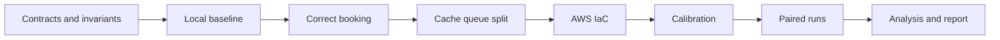

# Six-Week Implementation Roadmap

Execution tracking: GitHub milestones **M1–M8** and issues (see [Implementation plan](implementation-plan.md)). Frontend is **M8**, after the measurement path.

## Week 1: Contracts and local foundation

- Freeze API v1, schema, state machine, invariants, and fixture manifest.
- Scaffold frontend, services, database migrations, Docker Compose, and tests.
- Implement search/availability and baseline telemetry.
- Gate: deterministic seed and local read flow pass.

## Week 2: Correct booking path

- Implement atomic inventory claim, idempotency, payment stub, and reconciliation SQL.
- Implement baseline synchronous side effects.
- Add concurrency and timeout-after-commit tests.
- Gate: no oversell or duplicate payment in local contention tests.

## Week 3: Optimized path

- Split read/booking services.
- Add Redis cache-aside, stampede control, outbox, ElasticMQ/SQS contract, worker, and DLQ.
- Implement local baseline/optimized profiles.
- Gate: equivalent API results and all correctness tests pass.

## Week 4: AWS and observability

- Implement CloudFormation, IAM, networking, RDS, ECS, ALB, S3/CloudFront, SQS, optional Redis/replica.
- Add CloudWatch metrics/logs/traces and budget controls.
- Test deployment and complete destruction.
- Gate: minimal AWS smoke session stays within estimate and leaves no paid orphan.

## Week 5: Calibration and principal experiment

- Validate generator, calibrate rates, freeze hypotheses.
- Run randomized principal pairs with daily cost review.
- Run selected single-component failure tests.
- Gate: five valid pairs for primary cells or documented budget-driven reduction.

## Week 6: Analysis and delivery

- Reconcile all runs, compute paired intervals, and analyze cost.
- Build charts/dashboard and complete report.
- Re-run only preregistered invalid/missing cells.
- Perform reproducibility and teardown audit.
- Gate: another team member can follow the runbook from clean state.

## Dependency order

## Scope protection

Defer Cognito, real notifications, multi-region DR, ML bot detection, full segment inventory, Kubernetes, and predictive scaling until after the principal experiment is complete.
